# Toddler English

**An offline Android vocabulary app for children aged 1–5.**

Tap illustrated scenes to hear words, play gentle mini-games, and collect stickers with Pebble, a small seed-bird mascot.

[Build locally](#build-locally) · [Architecture](docs/ARCHITECTURE.md) · [Content](docs/CONTENT.md) · [Release guide](docs/RELEASE.md) · [Privacy](docs/privacy-policy.md)

## At a glance

| Platform | Learning content | Storage | Network |
| --- | --- | --- | --- |
| Android 7.0+ / API 24+ | 100 words, 5 scenes, 4 games, 7 chants | Local DataStore | No internet permission |

Content counts describe the checked-in catalogue. This repository is separate from the older [TinyTalk project](https://github.com/Haziq16/Tiny-Talks).

## What children can do

- Explore **Farm, Food, Home, Bedtime, and Outdoors** through pictures and bundled word audio.
- Pop word bubbles, find a matching picture, feed Pebble, and follow highlighted words in sing-along activities.
- Earn stickers through exploration and repeated play.
- Receive gentle audio and animation feedback, with no child-facing failure screen, streak, or countdown.

The **parent corner** sits behind a press-and-hold and arithmetic gate. It offers local progress summaries, word tiers, sound settings, and a session limit with a calm rest screen. Child touch targets are designed to be at least 64dp.

## How it works

| Layer | Responsibility |
| --- | --- |
| Compose UI | Navigation, illustrated scenes, games, stickers, parent screens |
| JSON content | Vocabulary, scene placements, game decks, chants, rewards |
| Audio | SoundPool for short clips; Media3 for longer tracks |
| DataStore | Local settings and progress counts |
| Verification | Content validator, JVM tests, Android UI audits, lint and ktlint |

Art and audio ship with the app. There are no accounts, ads, purchases, analytics, or backend. See [architecture](docs/ARCHITECTURE.md) for the source package map.

## Build locally

Use **JDK 17**, Android SDK **36**, Python 3, and the checked-in **Gradle 8.13** wrapper.

```sh
git clone https://github.com/Haziq16/toddler-english-app.git
cd toddler-english-app
python scripts/validate_content.py
./gradlew assembleDebug testDebugUnitTest lintDebug ktlintCheck
```

On Windows, use `gradlew.bat` in place of `./gradlew`. Android Studio can create your local SDK configuration. No API key or Firebase configuration is required.

The debug APK is written to `app/build/outputs/apk/debug/app-debug.apk`.

For an attached device or emulator:

```sh
./gradlew connectedDebugAndroidTest
```

## Repository map

| Location | Contents |
| --- | --- |
| [app/src/main/java/app/toddlerenglish](app/src/main/java/app/toddlerenglish) | App, content engine, games, audio, storage, and UI |
| [app/src/main/assets/content](app/src/main/assets/content) | Editable content catalogues |
| [app/src/main/assets/audio](app/src/main/assets/audio) | Bundled Ogg audio |
| [app/src/test](app/src/test) | Logic, content, accessibility-token, and privacy checks |
| [scripts](scripts) | Content validation and asset generation |
| [docs](docs) | Decisions, architecture, content, compliance, and release preparation |

## Status and release preparation

The existing [development log](docs/LOG.md) records completion of implementation sessions S0–S8 and earlier local checks. This README update does not constitute a new device or release validation.

Before distribution, the owner still needs to resolve the placeholder voice's redistribution rights, complete privacy-policy identity fields, confirm release configuration, and finish signing and store preparation. The seven tracks are **spoken rhythmic chants**, not professionally sung recordings. See [credits](docs/CREDITS.md), [compliance](docs/COMPLIANCE.md), and [release preparation](docs/RELEASE.md).

For changes, read [AGENTS.md](AGENTS.md), then the current log, plan, and decisions.
